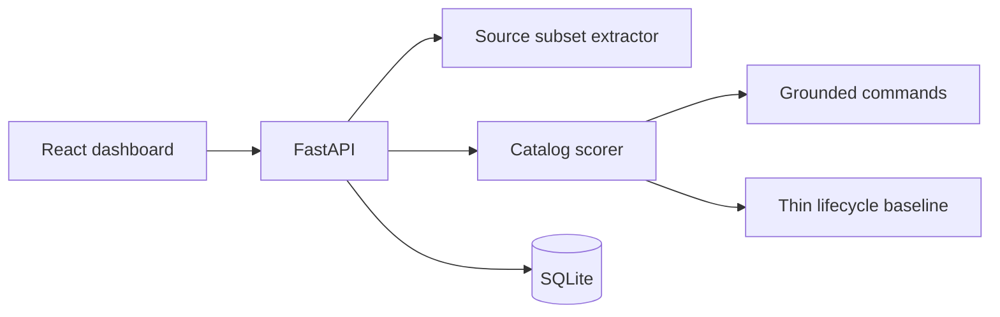

# prism-console-ryan-vo — Ryan Vo | AI & Machine Learning

> Work in progress. This checkpoint may be incomplete or fail tests. See PLAN.md and STATUS.md before use.


Prism Console helps a developer check a generated command-line interface before spending time repairing it by hand. Agents often emit a short lifecycle vocabulary (`start`, `stop`, `status`, `chat`, `meeting`) that does not match the handlers an application already exposes, and those commands still fail when they are run. This checkpoint scores a source-grounded catalog against that thin baseline. The intended user is a developer reviewing commands for an application whose callable surfaces can be declared, or pasted as a narrow Python or `ipcMain.handle` subset.

The grounded generator is a deterministic algorithm. It does not call a language model. One command is proposed for each surface, and the command is executable only when its name, HTTP route, and required flags bind. The thin generator always proposes the five lifecycle commands and binds one only when a single handler slug matches and that handler has no required parameters.

## What this checkpoint does

- Accept declared IPC, HTTP, and function surfaces, or extract them from pasted source.
- Python extraction uses `ast` and does not execute the file. It keeps module-level functions, skips names that start with `_`, and treats `@app.get("/path")`, `@router.post("/path")`, and `@api` method decorators with a string path as HTTP routes. Class methods are ignored. `*args` and `**kwargs` are recorded and are not executable.
- JavaScript and TypeScript files contribute `ipcMain.handle("group:name", (event, arg) => {})` callbacks whose parameters are identifiers. A colon in the channel splits the command group from the command name. Destructured parameters are reported and are not executable.
- Show coverage (share of surfaces bound by an executable command) and correctness (share of proposed commands that bind).
- Save each analysis in SQLite, write an audit row that stores counts rather than source text, and list, filter, open, and export the catalog.
- Run a labeled precision and recall comparison. The web page loads those numbers from the API.

Authentication, language-model explanations, and launching the target application are not implemented. See [PLAN.md](PLAN.md).

## AI/ML evaluation

The evaluation asks whether the grounded catalog recovers hand-labeled executable command paths, and how much of that set the thin lifecycle baseline recovers.

- Data: six hand-written inventories in `backend/app/core/evaluate.py`. They are not production traces. The gold paths were written to the bindability rules above (unique command path, supported kind, declared HTTP path parameters, and required flags present).
- Baseline: the thin generator, which proposes `app start`, `app stop`, `app status`, `app chat`, and `app meeting` with no flags.
- Command, from the repository root after the install below:

```bash
PYTHONPATH=backend .venv/bin/python -m app.core.evaluate
```

Measured on this checkpoint with that command:

| Generator | True positives | Predicted | Gold | Precision | Recall | F1 |
| --- | --- | --- | --- | --- | --- | --- |
| Grounded | 14 | 14 | 14 | 1.0 | 1.0 | 1.0 |
| Thin baseline | 1 | 2 | 14 | 0.5 | 0.071429 | 0.125 |

Grounded recall of 1.0 means the implementation agreed with those labels. It is not an external production benchmark. The thin baseline's only true positive in this set is `app start` on the health-service case. It also predicts `app status` there, which is a false positive because the grounded path is `health status`.

Failure cases, also listed by the evaluation payload:

- A thin command with no matching handler is not executable.
- The thin generator always uses the group name `app`, so a handler in another module is a different path.
- The thin vocabulary has no flags, so a matching handler with a required parameter fails binding.
- Duplicate command paths and unsupported kinds stay out of the executable set.
- Class methods are ignored.
- An `ipcMain.handle` callback with a destructured parameter list is outside the supported subset.
- Executable means the argv binds. The target application is not launched.

## Install and run

Requirements: Python 3.12 and Node 24. From the repository root:

```bash
python3 -m venv .venv
.venv/bin/pip install -r backend/requirements.txt
cd frontend && npm ci && cd ..
```

Run the API and the UI in two terminals. Both bind to loopback. The UI calls `/api` on its own origin, and Vite proxies that prefix to the API.

```bash
PYTHONPATH=backend .venv/bin/uvicorn app.main:app --host 127.0.0.1 --port 8000
```

```bash
cd frontend && npm run dev
```

Open `http://127.0.0.1:5173`. Load a sample, build a catalog, and use the history search to reopen a saved analysis.

Optional SQLite path, otherwise `./data/prism.sqlite`:

```bash
PRISM_DB=/absolute/path/prism.sqlite
```

Copy `.env.example` to `.env` only if you want that variable set. Leave the value blank to keep the default path. No credentials are required.

### Tests

```bash
PYTHONPATH=backend .venv/bin/python -m pytest backend/tests
cd frontend && npm run build && npm test
```

`npm run build` typechecks with `tsc --noEmit` and then runs the Vite build.

### Docker

The compose file publishes ports on `127.0.0.1` only. It does not include an identity provider.

```bash
docker compose up --build
```

The UI is at `http://127.0.0.1:8080` and proxies `/api` to the backend. The API is also on `http://127.0.0.1:8000` for local debugging. An empty named volume is initialized from the image directory `/data`, which is owned by uid 10001.

## Architecture



Docker and local uvicorn both use `app.main:app`, which calls `create_app`.

## API

| Method | Path | Behavior |
| --- | --- | --- |
| GET | `/api/health` | `status` and the version read from `VERSION` |
| GET | `/api/sample?kind=surfaces` or `python` | Example inventory |
| POST | `/api/analyses` | Score an inventory and store it |
| GET | `/api/analyses?application=&limit=&offset=` | Newest first. `limit` is 1–100. `application` is a substring, with `%` and `_` escaped |
| GET | `/api/analyses/{id}` | Stored catalog, including commands |
| GET | `/api/analyses/{id}/export` | Grounded commands as JSON, and an audit row |
| GET | `/api/audit?limit=&offset=` | Audit rows |
| GET | `/api/evaluation` | Labeled precision and recall |

Domain errors use HTTP 400 and `{"error", "field"}`. An unknown analysis is HTTP 404. A query parameter of the wrong type is HTTP 422 `{"error": "invalid request", "field": ""}`.

An inventory object needs `application` and at least one of `surfaces` or `files`. A surface has `id`, `kind` (`ipc`, `http`, or `function`), `module`, `handler`, optional `summary`, optional `method` and `path`, and `params` of `{name, type, required}`. A file has a relative `path` and `source`. Paths may not be absolute or contain `..`.

## Security limitations

- There is no login. Every endpoint is open. Keep the process on `127.0.0.1`. Do not publish it on a shared network.
- The service does not read a repository from disk. Callers paste file text. Pasted source is parsed and stored as assembled surfaces. Audit details store counts, not the source text.
- No language-model credential is read. `LLM_API_KEY`, `LLM_PROVIDER`, `LLM_MODEL`, and `LLM_BASE_URL` are unused in this checkpoint.
- This is not a security audit, and the product does not claim a certification.
- A TLS reverse proxy should terminate HTTPS in front of the UI if the checkpoint is ever moved off loopback. Forward only `/` and `/api` to the frontend, and do not expose the backend port beside it.
- Backup the SQLite file at `PRISM_DB` or in the `prism-data` volume while the API is stopped. Restore by replacing that file while the API is stopped.
- Identity-provider enrollment is not available. Keycloak and SAML brokering are planned and are not configured here.

## Roadmap

Planned, not implemented: replay of a user-supplied argv, scoring an agent-authored command list, advisory explanations from an operator-configured model provider, and Keycloak authorization-code login. Details are in [PLAN.md](PLAN.md) and [feature-plan.json](feature-plan.json).

Ryan Vo · ryandtvo@gmail.com
